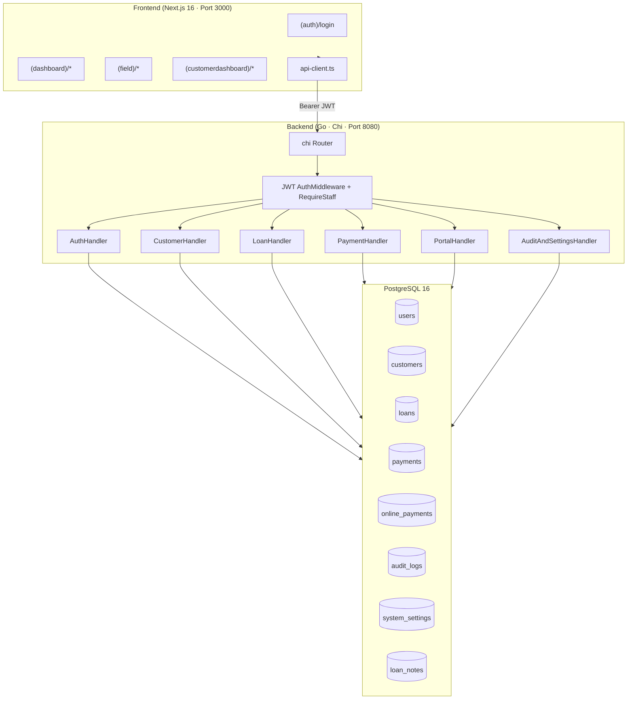
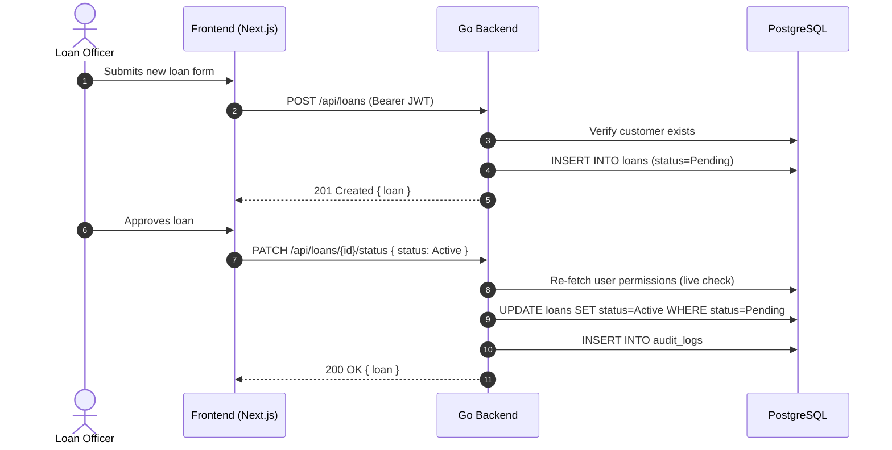
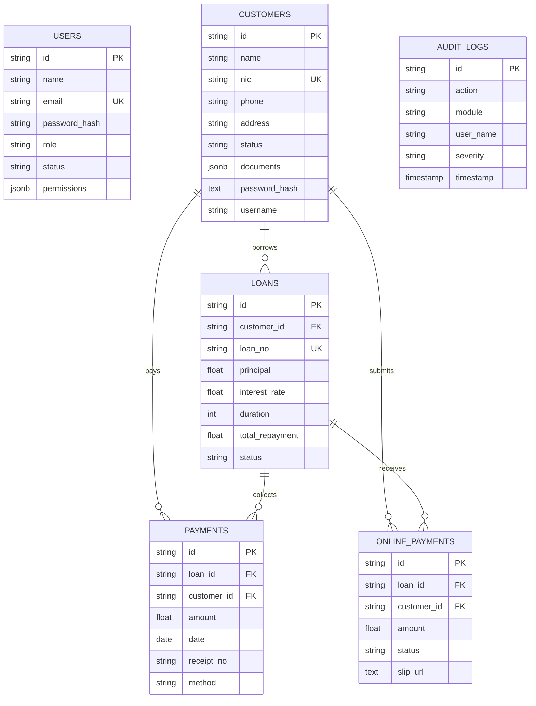
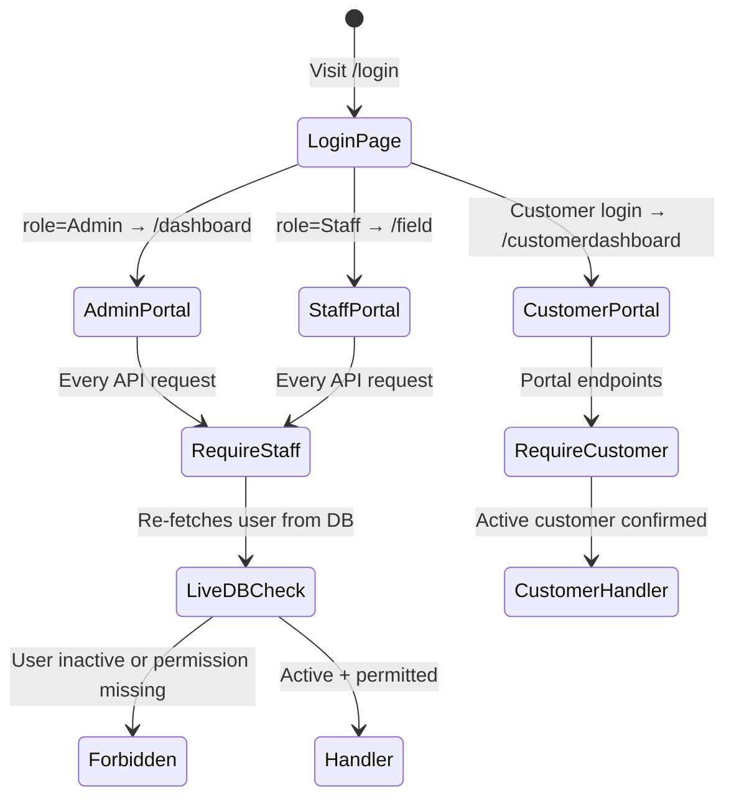

# PSI One Loan Management System (PSI One LMS)

[](https://nextjs.org/)
[](https://react.dev/)
[](https://www.typescriptlang.org/)
[](https://tailwindcss.com/)
[](https://go.dev/)
[](https://www.postgresql.org/)
[](#license)

> A modern, full-stack web application for microfinance institutions, credit cooperatives, and lending agencies to manage the complete loan lifecycle — from borrower onboarding and KYC, through loan disbursement and repayment collection, to portfolio analytics and audit trails.

---

## Table of Contents

- [Overview](#overview)
- [Features](#features)
- [Tech Stack](#tech-stack)
- [Architecture](#architecture)
- [Folder Structure](#folder-structure)
- [Database & Data Models](#database--data-models)
- [API Documentation](#api-documentation)
- [Default User Credentials](#default-user-credentials)
- [Local Setup (Without Docker)](#local-setup-without-docker)
- [Running with Docker](#running-with-docker)
- [Environment Variables](#environment-variables)
- [Database Migrations & Seeding](#database-migrations--seeding)
- [Authentication Flow](#authentication-flow)
- [Security](#security)
- [Deployment](#deployment)
- [Contributing](#contributing)
- [License](#license)
- [Author](#author)

---

## Overview

### What the Project Does
**PSI One LMS** is a full-stack administrative platform for managing end-to-end micro-loan and credit facility operations. It features:
- Comprehensive borrower KYC onboarding with document management
- Automated loan calculation (upfront fees, net disbursement, installment schedules)
- Daily repayment collection with sequential receipt generation
- Online payment slip submission and staff approval workflow
- Real-time portfolio analytics and delinquency monitoring
- Multi-role staff access control with granular permission enforcement
- Customer self-service portal for payment submission and account viewing
- Full audit trail logging for all system events

### The Problem It Solves
Traditional micro-lending relies on spreadsheets, paper ledgers, and disjointed desktop tools — causing calculation errors, lost identity documents, delayed delinquency visibility, and no standardized audit receipts. PSI One centralizes all operations into one secure, role-governed platform.

### Who It Is For
- **Microfinance Institutions (MFIs)** & Community Credit Cooperatives
- **Credit Lending Companies** with daily, weekly, or monthly repayment schedules
- **Loan Officers & Field Collection Agents** needing quick access to borrower balances
- **Finance Managers & Auditors** monitoring portfolio yield, disbursement volume, and default rates

---

## Features

### Customer Directory & KYC Management
- Comprehensive borrower profiles: NIC, DOB, gender, contacts, occupation, income
- Sri Lankan geographic coverage: all 25 administrative districts
- Guarantor details and emergency contacts
- Document uploads: NIC front/back, photos, salary slips, agreements
- Legacy borrower onboarding with existing loan capture
- Customer portal accounts with secure login

### Loan Origination & Financial Calculator
- 3-step guided loan origination wizard
- Flexible rate periods: Daily, Weekly, Monthly, Flat
- Repayment frequencies: Daily, Weekly, Monthly
- Automated upfront fee deduction engine (capital, interest, processing, admin fees)
- Real-time financial calculations:
  $$\text{Net Disbursement} = \max(0,\ \text{Gross Principal} - \text{Total Deductions})$$
  $$\text{Total Interest} = \text{Principal} \times \frac{\text{Rate}}{100} \times \text{Periods}$$
  $$\text{Installment} = \frac{\text{Total Repayment}}{\text{Duration}}$$
- Loan status lifecycle: `Pending → Active → Completed / Overdue / Rejected`
- Loan approval/rejection with notes and approver tracking

### Repayment Processing & Receipt Generation
- Fast repayment logging for active/overdue loans
- Payment allocation: Capital, Interest, or Other fees
- Multi-channel tender: Cash, Bank Transfer, Cheque
- Auto-generated sequential receipt numbers (`REC-YYYY-XXXX`) via PostgreSQL sequence
- Automatic loan status settlement when total paid ≥ total repayment
- Online bank slip submission workflow with staff approval/rejection and concurrency protection

### Portal & Self-Service
- Customer-facing portal at `/customerdashboard`
- Login via NIC, email, username, phone, or Customer ID
- View own loans, payment history, and outstanding balance
- Submit online bank transfer slips for approval

### Financial Analytics & Audit
- Portfolio health dashboard: active, overdue, completed, pending loans
- Collection efficiency metrics
- Full audit log with timestamped actions, roles, IP addresses, severity
- Settings management: interest defaults, fees, grace period

### Staff Management & Access Control
- Roles: `Admin`, `Staff`
- Granular permission matrix per user:
  - Approve Loans
  - Record Repayments
  - Export Reports
  - Manage Settings
  - Manage Customers
- Real-time DB permission re-check on every protected request (stale JWT protection)
- Staff deactivation immediately revokes access

---

## Tech Stack

### Frontend

| Category | Technology | Version |
|:---|:---|:---|
| Framework | [Next.js](https://nextjs.org/) | `16.4.3` |
| UI Library | [React](https://react.dev/) | `19.3.0` |
| Language | [TypeScript](https://www.typescriptlang.org/) | `^5.0` |
| Styling | [Tailwind CSS](https://tailwindcss.com/) | `^4.0` |
| Icons | [Lucide React](https://lucide.dev/) | `^1.55.0` |
| State | React Context API | Native |
| HTTP Client | Custom `api-client.ts` (fetch) | — |

### Backend

| Category | Technology | Version |
|:---|:---|:---|
| Language | [Go](https://go.dev/) | `1.22` |
| Router | [chi](https://github.com/go-chi/chi) | `v5.0.12` |
| CORS | go-chi/cors | `v1.2.1` |
| Auth | [golang-jwt/jwt](https://github.com/golang-jwt/jwt) | `v5.2.1` |
| DB Driver | [lib/pq](https://github.com/lib/pq) | `v1.10.9` |
| Password | golang.org/x/crypto (bcrypt) | `v0.23.0` |
| Config | [godotenv](https://github.com/joho/godotenv) | `v1.5.1` |

### Database

| Category | Technology | Version |
|:---|:---|:---|
| Database | [PostgreSQL](https://www.postgresql.org/) | `16` |
| Container | Docker / docker-compose | optional |

---

## Architecture

### System Architecture



### Data Flow — Loan Approval



---

## Folder Structure

```text
loan-management/
├── backend/                        # Go REST API backend
│   ├── cmd/
│   │   ├── admin/                  # CLI admin utility
│   │   │   └── main.go
│   │   └── server/
│   │       ├── main.go             # Server entrypoint & router
│   │       └── integration_test.go # Full API integration test suite
│   ├── config/
│   │   └── config.go               # Env config loader
│   ├── database/
│   │   ├── database.go             # PostgreSQL connection pool
│   │   ├── seed.sql                # Seed data (roles, users, settings)
│   │   └── migrations/
│   │       ├── 001_init.sql        # Core schema (all tables)
│   │       └── 002_frontend_integration.sql  # Portal columns, sequences, loan_notes
│   ├── handlers/
│   │   ├── auth_handler.go         # Login, GetMe, ListUsers
│   │   ├── customer_handler.go     # CRUD customers, documents
│   │   ├── loan_handler.go         # CRUD loans, status updates
│   │   ├── payment_handler.go      # Payments, online payments
│   │   ├── audit_and_settings_handler.go
│   │   └── integration_handler.go  # Portal, shared helpers, RequireStaff
│   ├── middleware/
│   │   └── auth.go                 # JWT middleware, GenerateToken, RequireRole
│   ├── models/
│   │   └── models.go               # All domain models (User, Customer, Loan, etc.)
│   ├── repository/
│   │   ├── user_repo.go
│   │   ├── customer_repo.go
│   │   ├── loan_repo.go
│   │   ├── payment_repo.go
│   │   ├── audit_and_settings_repo.go
│   │   └── integration_repo.go     # Txn logic: settlement, concurrent approval
│   ├── .env.example
│   ├── docker-compose.yml
│   └── go.mod / go.sum
│
├── src/                            # Next.js frontend
│   ├── app/
│   │   ├── (auth)/login/           # Unified login page (Admin/Staff/Customer)
│   │   ├── (dashboard)/            # Admin dashboard (role: Admin)
│   │   │   ├── dashboard/
│   │   │   ├── customers/
│   │   │   ├── loans/
│   │   │   ├── repayments/
│   │   │   ├── collections/
│   │   │   ├── overdue/
│   │   │   ├── reports/
│   │   │   ├── online-payments/
│   │   │   ├── users/
│   │   │   ├── settings/
│   │   │   └── audit-logs/
│   │   ├── (field)/                # Staff / Field officer dashboard
│   │   ├── customerdashboard/      # Customer self-service portal
│   │   ├── globals.css
│   │   └── layout.tsx
│   ├── components/
│   │   ├── layout/                 # Sidebar, topbar
│   │   ├── forms/
│   │   ├── modals/
│   │   └── shared/
│   ├── lib/
│   │   ├── api-client.ts           # Typed fetch wrapper for all API calls
│   │   ├── demo-data.ts            # Fallback seed data
│   │   └── loan-calculator.ts      # Loan math utilities
│   ├── providers/
│   │   └── data-provider.tsx       # React Context + localStorage sync
│   └── types/
│       └── index.ts                # TypeScript domain interfaces
│
├── package.json
├── next.config.ts
├── tsconfig.json
├── AGENTS.md
└── README.md
```

---

## Database & Data Models

### PostgreSQL Tables

| Table | Description |
|-------|-------------|
| `users` | Staff and admin accounts with roles and permissions (JSONB) |
| `customers` | Borrower profiles with KYC data, documents (JSONB), portal credentials |
| `loans` | Loan records with full financial details, status lifecycle |
| `payments` | Repayment ledger entries linked to loans |
| `online_payments` | Bank slip submissions from customer portal |
| `audit_logs` | Timestamped system event trail |
| `system_settings` | Single-row global configuration (interest rates, fees) |
| `loan_notes` | Staff promise/follow-up notes per loan |

### Entity Relationship Diagram



---

## API Documentation

All API endpoints are served from the Go backend at `http://localhost:8080`.

### Auth

| Method | Endpoint | Auth | Description |
|--------|----------|------|-------------|
| `POST` | `/api/auth/login` | Public | Staff login → returns JWT |
| `GET` | `/api/auth/me` | Bearer | Get current staff profile |
| `POST` | `/api/portal/login` | Public | Customer portal login → returns JWT |
| `POST` | `/api/portal/register` | Public | Customer self-registration |
| `GET` | `/api/portal/me` | Bearer (Customer) | Customer snapshot (loans, payments) |

### Customers

| Method | Endpoint | Permission | Description |
|--------|----------|------------|-------------|
| `GET` | `/api/customers` | Staff | List all customers |
| `GET` | `/api/customers/{id}` | Staff | Get customer by ID |
| `GET` | `/api/customers/lookup?query=` | Staff | Lookup by NIC, phone, email |
| `POST` | `/api/customers` | `manageCustomers` | Create customer |
| `PUT` | `/api/customers/{id}` | `manageCustomers` | Update customer |
| `DELETE` | `/api/customers/{id}` | `manageCustomers` | Delete customer |
| `POST` | `/api/customers/{id}/documents` | `manageCustomers` | Add document |
| `DELETE` | `/api/customers/{id}/documents/{docId}` | `manageCustomers` | Remove document |

### Loans

| Method | Endpoint | Permission | Description |
|--------|----------|------------|-------------|
| `GET` | `/api/loans` | Staff | List all loans (filter by `?customerId=`) |
| `GET` | `/api/loans/{id}` | Staff | Get loan details |
| `POST` | `/api/loans` | `manageCustomers` | Create loan |
| `PATCH` | `/api/loans/{id}/status` | `approveLoans` | Approve or reject loan |
| `DELETE` | `/api/loans/{id}` | Admin | Delete Pending/Rejected loan |
| `GET` | `/api/loan-notes` | Staff | Get all loan follow-up notes |
| `PUT` | `/api/loans/{id}/note` | `recordRepayments` | Save follow-up note |

### Payments

| Method | Endpoint | Permission | Description |
|--------|----------|------------|-------------|
| `GET` | `/api/payments` | Staff | List payments (filter by `?loanId=` or `?customerId=`) |
| `POST` | `/api/payments` | `recordRepayments` | Record repayment (auto-settles loan) |
| `PUT` | `/api/payments/{id}` | Admin | Edit payment |
| `DELETE` | `/api/payments/{id}` | Admin | Delete payment |

### Online Payments

| Method | Endpoint | Permission | Description |
|--------|----------|------------|-------------|
| `GET` | `/api/online-payments` | Staff | List slips (filter by status/loanId/customerId) |
| `POST` | `/api/portal/online-payments` | Bearer (Customer) | Submit bank slip |
| `POST` | `/api/online-payments` | `recordRepayments` | Staff direct slip submission |
| `PATCH` | `/api/online-payments/{id}/approve` | `recordRepayments` | Approve slip (atomic, concurrency-safe) |
| `PATCH` | `/api/online-payments/{id}/reject` | `recordRepayments` | Reject slip |

### Users, Settings & Audit

| Method | Endpoint | Permission | Description |
|--------|----------|------------|-------------|
| `GET` | `/api/users` | Staff | List staff users |
| `POST` | `/api/users` | Admin | Create staff user |
| `PUT` | `/api/users/{id}` | Admin | Update staff user |
| `GET` | `/api/settings` | Staff | Get system settings |
| `PUT` | `/api/settings` | `manageSettings` | Update settings |
| `GET` | `/api/audit-logs` | Staff | Get audit logs (default limit 100) |
| `GET` | `/health` | Public | Health check |

---

## Default User Credentials

> [!IMPORTANT]
> These are the seeded default accounts. Change passwords after first login in production.

| Role | Name | Email | Password | Portal | Redirects To |
|------|------|-------|----------|--------|--------------|
| 🔴 **Admin** | System Admin | `admin@psione.lk` | `admin123` | Admin tab | `/dashboard` |
| 🟡 **Staff** | Staff Officer | `staff@psione.lk` | `Staff@123` | Staff / Field tab | `/field` |
| 🟢 **Customer** | Demo Customer | `customer@psione.lk` | `Customer@123` | Customer tab | `/customerdashboard` |

### Permission Matrix

| Permission | Admin | Staff | Customer |
|------------|:-----:|:-----:|:--------:|
| Approve Loans | ✅ | ✅ | ❌ |
| Record Repayments | ✅ | ✅ | ❌ |
| Export Reports | ✅ | ❌ | ❌ |
| Manage Settings | ✅ | ❌ | ❌ |
| Manage Customers | ✅ | ✅ | ❌ |

---

## Local Setup (Without Docker)

### Prerequisites

| Tool | Version | Download |
|------|---------|----------|
| Node.js | 20+ | [nodejs.org](https://nodejs.org/) |
| pnpm | latest | `npm install -g pnpm` |
| Go | 1.22+ | [go.dev/dl](https://go.dev/dl/) |
| PostgreSQL | 14+ | [postgresql.org](https://www.postgresql.org/download/) |

### Step 1 — PostgreSQL Database

```powershell
# Create the database
psql -U root -c "CREATE DATABASE loan_management;"
```

### Step 2 — Run Migrations & Seed

```powershell
# Core tables
psql -U root -d loan_management -f backend\database\migrations\001_init.sql

# Portal columns, receipt sequence, loan_notes
psql -U root -d loan_management -f backend\database\migrations\002_frontend_integration.sql

# Default users, roles, system settings
psql -U root -d loan_management -f backend\database\seed.sql
```

### Step 3 — Configure Backend `.env`

```powershell
Copy-Item backend\.env.example backend\.env
```

Edit `backend\.env` to match your PostgreSQL credentials:

```env
PORT=8080
ENV=development

DB_HOST=localhost
DB_PORT=5432
DB_USER=root
DB_PASSWORD=1234
DB_NAME=loan_management
DB_SSLMODE=disable

JWT_SECRET=super-secret-jwt-key-loan-mgmt-system-psi-2026
ALLOWED_ORIGINS=http://localhost:3000,http://127.0.0.1:3000
```

### Step 4 — Start the Go Backend

```powershell
cd backend
go mod download
go run ./cmd/server
# → http://localhost:8080
# → GET http://localhost:8080/health should return {"status":"UP",...}
```

### Step 5 — Start the Next.js Frontend

Open a second terminal:

```powershell
pnpm install
pnpm dev
# → http://localhost:3000
```

---

## Running with Docker

```powershell
cd backend
docker-compose up -d
```

This starts **PostgreSQL 16** on port `5432` and auto-runs all 3 SQL files (migrations + seed) via `docker-entrypoint-initdb.d`.

Then run the backend and frontend as in Steps 4 & 5 above.

---

## Environment Variables

### Backend (`backend/.env`)

| Variable | Required | Default | Description |
|----------|----------|---------|-------------|
| `PORT` | No | `8080` | Go server port |
| `ENV` | No | `development` | Runtime environment |
| `DB_HOST` | Yes | `localhost` | PostgreSQL host |
| `DB_PORT` | Yes | `5432` | PostgreSQL port |
| `DB_USER` | Yes | `postgres` | PostgreSQL username |
| `DB_PASSWORD` | Yes | `postgres` | PostgreSQL password |
| `DB_NAME` | Yes | `loan_management_db` | PostgreSQL database name |
| `DB_SSLMODE` | No | `disable` | PostgreSQL SSL mode |
| `JWT_SECRET` | Yes | — | Secret for signing JWTs (min 32 chars in production) |
| `ALLOWED_ORIGINS` | No | `http://localhost:3000` | Comma-separated CORS origins |

### Frontend

No mandatory environment variables. The frontend calls `http://localhost:8080` by default via `api-client.ts`.

---

## Database Migrations & Seeding

### Migration Files (run in order)

| File | Description |
|------|-------------|
| `001_init.sql` | Creates all tables: `users`, `customers`, `loans`, `payments`, `online_payments`, `audit_logs`, `system_settings` |
| `002_frontend_integration.sql` | Adds `password_hash`/`username` to customers, creates `receipt_number_seq` sequence, creates `loan_notes` table |
| `seed.sql` | Inserts default roles, 3 users (Admin/Staff/Customer), system settings, initial audit log |

### Re-run Seed Safely

The seed uses `ON CONFLICT DO UPDATE` — safe to re-run without wiping data:

```powershell
psql -U root -d loan_management -f backend\database\seed.sql
```

### Verify Tables

```powershell
psql -U root -d loan_management -c "\dt"
```

Expected tables:
```
 audit_logs | customers | loan_notes | loans | online_payments | payments | system_settings | users
```

---

## Authentication Flow



**Key design decisions:**
- JWT issued for 24 hours but `RequireStaff` re-fetches the live user on **every** protected request — revoking access immediately on deactivation
- Customer tokens are scoped to `Role: "Customer"` and are blocked from all staff endpoints
- Online payment approval uses `FOR UPDATE` row locking to prevent concurrent double-approvals

---

## Security

### Implemented
- ✅ bcrypt password hashing (all users and customers)
- ✅ JWT authentication (HS256, 24h expiry)
- ✅ Live DB permission re-check on every request (stale token protection)
- ✅ Customer cross-scoping blocked (can't submit payment for another customer's loan)
- ✅ Concurrent approval prevention via PostgreSQL `FOR UPDATE` row locking
- ✅ Receipt numbers server-enforced via DB sequence (client-provided values ignored)
- ✅ Password never returned in API responses
- ✅ CORS restricted to configured origins

### Recommended for Production
- [ ] Change all default seed passwords before first deployment
- [ ] Set a strong `JWT_SECRET` (32+ random characters)
- [ ] Enable PostgreSQL SSL (`DB_SSLMODE=require`)
- [ ] Add rate limiting on `/api/auth/login` and `/api/portal/login`
- [ ] Store KYC document files in private cloud storage (AWS S3 / Cloudflare R2) instead of base64

---

## Deployment

### Frontend — Vercel (Recommended)

1. Push to GitHub
2. Import into [Vercel Dashboard](https://vercel.com/new)
3. Set environment variables for the backend API URL
4. Deploy

### Backend — Any Linux Server

```bash
cd backend
go build -o psi-lms-server ./cmd/server
./psi-lms-server
```

Or use the included `docker-compose.yml` for a containerized PostgreSQL instance.

---

## Contributing

1. **Fork** the repository
2. **Create a feature branch:**
   ```bash
   git checkout -b feature/your-feature-name
   ```
3. **Commit your changes:**
   ```bash
   git commit -m "feat: describe your change"
   ```
4. **Push and open a Pull Request**

---

## License

This project is proprietary software developed by **Perfect Solution International**. All rights reserved.

---

## Author

**Perfect Solution International**
- **Organization:** [Perfect Solution International](https://github.com/Perfect-Solution-International)
- **Repository:** [Loan-management-system](https://github.com/Perfect-Solution-International/Loan-management-system)
- **Contact:** `support@psione.lk`
- **Location:** Sri Lanka
